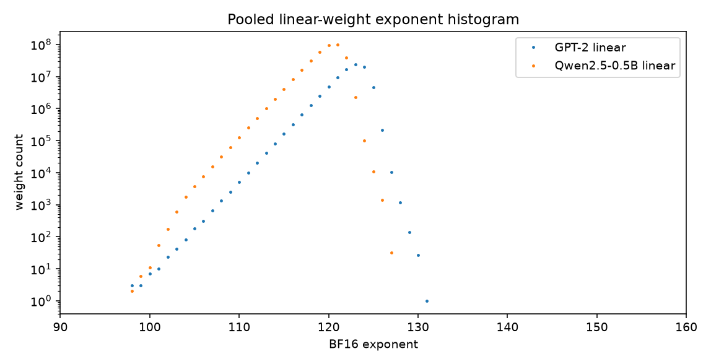
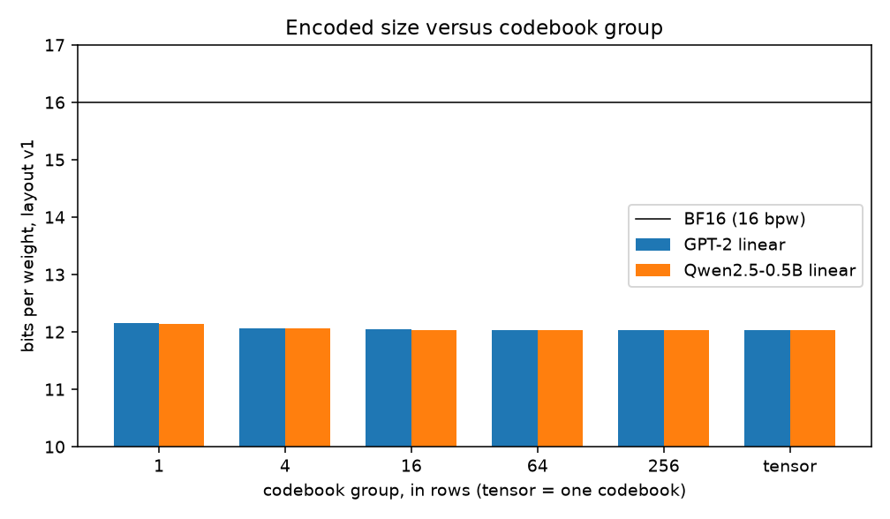
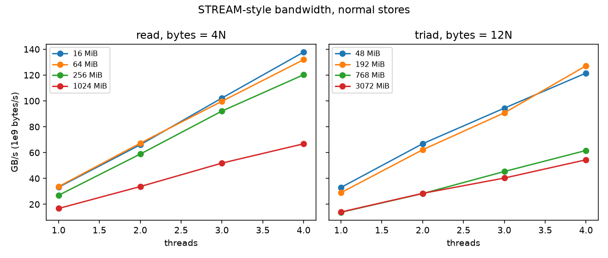
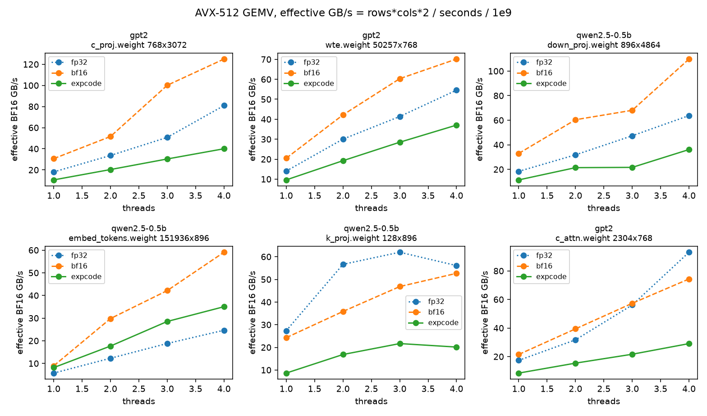
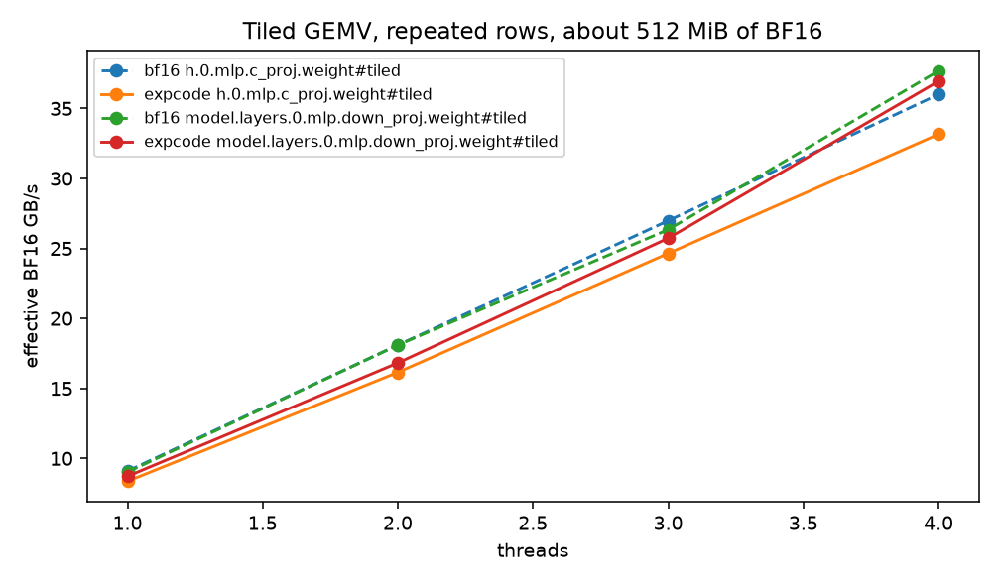
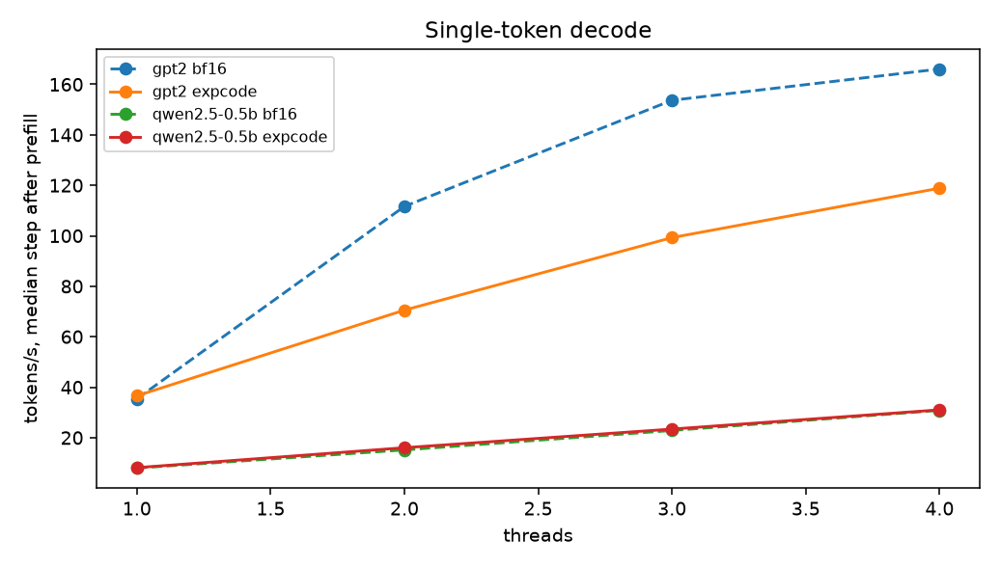

# bf16-exponent-gemv

Bit-exact BF16 weights, exponent-coded at about 12.03 bits per weight, decoded inside an AVX2 and AVX-512 GEMV.

## Problem

A batch-1 decode GEMV is `y = W x` with `W` in BF16 and the dot accumulated in binary32. Each weight is loaded once. The arithmetic is two FLOPs per weight (multiply and add) and the BF16 matrix is two bytes per weight, so the arithmetic intensity is 1 FLOP/byte. At that intensity the kernel's speed is the speed of the weight stream.

DFloat11 (arXiv:2504.11651) measured the 8-bit BF16 exponent of LLM weights at about 2.6 bits of entropy. The sign bit and the 7-bit mantissa are close to incompressible. A code that spends its bits on the exponent, and stores sign and mantissa raw, can shrink the matrix without changing a single weight. This repository does that with a fixed-rate code so the decode is a register permute inside the GEMV, and it requires the binary32 result to match a plain BF16 GEMV in one specified summation order.

## Go / no-go

`python/analyze_exponents.py` histogrammed every 2D weight in two models and scored the v1 layout below. GPT-2 (`openai-community/gpt2`, revision `607a30d783dfa663caf39e06633721c8d4cfcd7e`) is stored as FP32 and was converted with round-to-nearest-even; Hugging Face Conv1D matrices were transposed from `[in, out]` to GEMV `[out, in]`. Qwen2.5-0.5B (`Qwen/Qwen2.5-0.5B`, revision `060db6499f32faf8b98477b0a26969ef7d8b9987`) is native BF16 and already `[out, in]`. Token and position tables were not transposed. The pooled numbers are in `results/histograms.json`.

Linear weights only (layer matrices, no embeddings):

| pool | weights | H(exponent), pooled | H(sign), weight avg | H(mantissa), weight avg | sign+mantissa + H(exp) | per-row bpw | per-tensor bpw | per-tensor escape |
| --- | ---: | ---: | ---: | ---: | ---: | ---: | ---: | ---: |
| GPT-2 linear | 84,934,656 | 2.667 | 1.000 | 6.972 | 10.667 | 12.157 | 12.034 | 0.0330% |
| Qwen2.5-0.5B linear | 357,826,560 | 2.645 | 1.000 | 6.957 | 10.645 | 12.137 | 12.030 | 0.0288% |

Per-tensor encoding is 24.79% smaller than 16 bpw on GPT-2 linear and 24.81% smaller on Qwen linear. The gap from the entropy bound (10.65 to 10.67 bpw) up to 12.03 bpw is the fixed 4-bit code, the 15-entry codebook, the escape bytes, and the per-row escape index. Embeddings land in the same place: GPT-2 `wte`+`wpe` pooled exponent entropy 2.639 and 12.044 bpw per tensor; Qwen `embed_tokens` exponent entropy 2.579 and 12.037 bpw, escape rate 0.0199%.

A row rarely needs many exponents, but it is not always under 15. Weight-averaged fraction of linear rows with at most 15 distinct exponents: 0.946 (GPT-2) and 0.888 (Qwen). The maximum in a linear row is 23 (GPT-2) and 21 (Qwen). The worst linear matrix is GPT-2 `h.11.mlp.c_proj` (79.3% of rows have at most 15 exponents) and Qwen `model.layers.16.mlp.down_proj` (56.3%). Those extra exponents are rare: weight-averaged top-15 coverage is 0.99967 (GPT-2) and 0.99971 (Qwen), top-8 coverage is 0.983 on both, and top-32 coverage is 1. That is why a 15-entry codebook plus a sparse escape stays under 0.04% escaped weights even when about 11% of Qwen rows do not fit in 15 exponents.

The cut is about a quarter of the BF16 bytes. That is large enough to justify a kernel. Decision: go. Default codebooks in the GEMV benchmark are one per tensor, which is the smallest of the group sizes that were scored.





## Encoding format, layout v1

Little-endian. Multi-byte integers are stored with explicit byte stores. The header is not a C struct, so host padding cannot change it. Sections follow the header with no alignment padding. Magic is `0x31435845` (`EXC1` on a little-endian host). Version is 1. `code_bits` is 4.

### Header (64 bytes)

| offset | size | field |
| ---: | ---: | --- |
| 0 | 4 | magic `0x31435845` |
| 4 | 2 | version = 1 |
| 6 | 2 | code_bits = 4 |
| 8 | 4 | rows |
| 12 | 4 | cols |
| 16 | 4 | group_rows (at least 1). `encode(..., 0)` stores `rows`, one codebook for the matrix |
| 20 | 4 | code_stride = `(cols + 1) / 2` |
| 24 | 4 | sm_stride = cols |
| 28 | 4 | n_groups = ceil(rows / group_rows) |
| 32 | 4 | flags. bit 0 set iff the escape stream is non-empty |
| 36 | 4 | codebook_nbytes |
| 40 | 4 | codes_nbytes |
| 44 | 4 | sm_nbytes |
| 48 | 4 | escape_index_nbytes |
| 52 | 4 | escape_nbytes |
| 56 | 8 | reserved, zero |

### Sections, in order, starting at byte 64

| section | size | contents |
| --- | --- | --- |
| codebook | `n_groups * 16` | byte `i` in `0..14` is the BF16 exponent selected by code `i`. Byte 15 is written 0 and is not a real exponent. Group `g` covers rows `[g * group_rows, min(rows, (g+1) * group_rows))` |
| codes | `rows * code_stride` | row-major nibbles. Byte `j` holds code(column `2j`) in bits 3:0 and code(`2j+1`) in bits 7:4. If `cols` is odd the high nibble of the last byte is 0 |
| sign_mant | `rows * cols` | row-major. Bit 7 is the BF16 sign. Bits 6:0 are the BF16 mantissa |
| escape_index | `4 * (rows + 1)` | little-endian uint32 byte offsets into the escape section. Row `r` owns `[index[r], index[r+1])`. The last entry is a sentinel so any row is O(1). The table may be misaligned; readers use byte loads |
| escapes | `escape_nbytes` | raw exponent bytes, row-major, and within a row in increasing column order. There is no position side-index. A nibble equal to 15 is the position marker and consumes one escape byte |

Byte count, shared by `encoded_storage_bytes` and the Python scorer:

```
64 + n_groups*16 + rows*((cols+1)//2) + rows*cols + n_escape + 4*(rows+1)
```

Reconstruction of one weight:

```
bf16 = ((sign_mant & 0x80) << 8) | (exponent << 7) | (sign_mant & 0x7F)
fp32 = bf16 << 16          # exact, including subnormals, infinities, and the NaN payload in mantissa bits [22:16]
```

Codebook selection inside a group: count exponents, drop empty bins, sort by descending count and then by ascending exponent, keep 15. Code 0 is the most preferred exponent. Any other exponent is code 15 and is appended to that row's escape span.

`include/expcode/codec.hpp` is the header-only implementation (`EncodedMatrix::encode`, `parse_copy`, `MatrixView`). `include/expcode/bf16.hpp` and `format.hpp` have no GEMV dependency. A KV-cache compressor that wants the same exponent code (the layout used by cvs0/compressed-kv-attention) includes those headers and does not link `expcode_kernels`.

The `.bpk` files written by `python/export_bf16.py` are a separate container (`BPK1`, magic `0x314B5042`) of named BF16 tensors. They are not the expcode layout, and they are not committed.

## Kernel

### Summation order

Every backend (scalar, AVX2, AVX-512) computes, for each row,

```
partial[c & 63] = fma(w[c], x[c], partial[c & 63])
y = partial[0] + partial[1] + ... + partial[63]
```

with round-to-nearest-even and contraction off. `x` is binary32, promoted from BF16 once per GEMV, outside the row loop. `w[c]` is the BF16 weight promoted by a 16-bit left shift. Sixty-four partials are 8 AVX2 registers or 4 AVX-512 registers.

Lane map, with `c` a multiple of 64:

| ISA | register | columns |
| --- | --- | --- |
| AVX2 | `acc[k]`, k = 0..7 | `c + 8k` .. `c + 8k + 7` |
| AVX-512 | `acc[k]`, k = 0..3 | `c + 16k` .. `c + 16k + 15` |

`vdpbf16ps` is a different product (two BF16 products summed inside the instruction) and is not used. `_mm512_reduce_add_ps` is not used for `y`. A single left-to-right accumulator is a different binary32 function; `tests/test_main.cpp` checks that `1e20`, `1`, `-1e20` placed on partials 0 and 1 disagree with that chain.

`exact_fma` is `vfmadd231ss` (via `_mm_fmadd_ss`) so a scalar tail and a vector FMA return the same NaN payload. `std::fma` under Clang is a libm call and does not. `exact_add` is `vaddss` with the accumulator forced into src1. On Intel, the sum of two NaNs keeps the src1 payload, and a C `+` lets the compiler swap operands. Both GCC 13 and Clang 18 match the scalar reference on all 65536 BF16 patterns with these two instructions. `set_ieee_fp_env` clears MXCSR FTZ (bit 15) and DAZ (bit 6) and sets RC to nearest-even. A BF16 subnormal is a binary32 subnormal in bits [30:16]; FTZ or DAZ would flush it.

### Decode

The fast path handles a 64-column block whose 32 code bytes contain no nibble equal to 15. The 16-byte codebook is a `vpshufb` table (`_mm_shuffle_epi8`). Codes are 0..14, so the index high bit is clear and `vpshufb` returns the table byte. Code 15 is not fed to this path: table byte 15 is 0 and would invent a zero exponent.

Nibble split of a packed byte: `lo = b & 0x0F`, `hi = (srli_epi16(b, 4)) & 0x0F`. `srli_epi16` crosses a byte pair; the `0x0F` mask drops the bits that shifted in from the next byte. `unpacklo_epi8(lookup(lo), lookup(hi))` restores column order. The exponent is shifted to binary32 bits [30:23], the sign to bit 31, and the mantissa to bits [22:16].

A dirty 64-column block stores the eight or four accumulators to `float partial[64]`, runs `accum_encoded_range` (the same scalar loop as the reference, which consumes escape bytes in order), and reloads the accumulators. The tail after the last multiple of 64 uses that scalar loop too. On the exported matrices the dirty fraction of 64-column blocks with a per-tensor codebook is 2.82% for GPT-2 `h.0.mlp.c_proj` (768×3072), 1.70% for Qwen `down_proj` (896×4864), and 1.27% for Qwen `embed_tokens` (151936×896). Per-row codebooks cut those fractions to 0.70%, 0.71%, and 0.01%.

Rows are split statically across OpenMP threads. Thread 1 does not enter a parallel region. Each thread owns whole rows, and each row's escape pointer starts at `escape_index[row]`, so threads do not share an escape pointer. `detect_isa` is cached after the first call. `Backend::Auto` picks AVX-512F+BW, then AVX2+FMA, then scalar. Requesting an ISA the CPU does not have throws.

The decode loop in `src/model.cpp` is a real single-token step, not a GEMV replay. GPT-2: tied `wte` lookup plus `wpe`, pre-LN (`eps = 1e-5`), `c_attn` (QKV packed), FP32 KV cache, causal attention, `c_proj`, pre-LN, `c_fc`, GELU-new (`0.5 * x * (1 + tanh(sqrt(2/pi) * (x + 0.044715 * x^3)))` with the constant `0.7978845608028654`), MLP projection, final LN, LM head = `wte`. Qwen2.5-0.5B: tied embedding, RMSNorm (`eps = 1e-6`), Q/K/V with bias, RoPE `rotate_half` with `inv_freq = exp(-log(theta) * 2i / head_dim)` and `theta = 1e6`, GQA (14 query heads, 2 KV heads, head dim 64), output projection, RMSNorm, SwiGLU `silu(gate) * up`, down projection, final RMSNorm, LM head = `embed_tokens`. The KV cache is uncompressed FP32. Attention, norms, GELU, SiLU, and RoPE are scalar and shared by both weight backends, so they cancel in the bit-exact comparison. Dropout is the identity. The GEMV is the bit-exact contract. Logits are not compared to a Hugging Face forward.

## Roofline

Machine, from the benchmark process (`results/bench.json`) and sysfs. KVM guest. `Intel(R) Xeon(R) Processor`, CPUID family 6, model 207, stepping 2, 4 logical CPUs, 1 thread per core, constant TSC, `cpu MHz` 2400.000. Flags include AVX2, FMA, AVX-512F, AVX-512BW, AVX-512BF16, AMX. Guest-visible caches: L1d 48 KiB × 4, L1i 32 KiB × 4, L2 2 MiB × 4, L3 320 MiB shared. RAM 16,387,280 KiB. Compiler for the timed binary: `g++` 13.3.0, CMake `Release` (`-O3`), `-mfma -ffp-contract=off -fno-tree-vectorize`. The 320 MiB L3 figure is what the guest exports; a 4-vCPU slice of a large Xeon often shows the host socket's L3.

Single-thread FMA loop, 8 independent accumulators, each FMA counted as 2 FLOPs, per-iteration `asm volatile` memory clobber so the compiler cannot close the recurrence: AVX2 46.07 GFLOP/s, AVX-512 84.63 GFLOP/s. The clobber limits overlap across iterations, so these are lower bounds on port throughput, not a vendor peak. One AVX-512 FMA per cycle at 2.4 GHz is 76.8 GFLOP/s (`16 lanes * 2 flops * 2.4 GHz`). The measured 84.6 sits just above that one-pipe line.

STREAM-style kernels, GB/s = 1e9 bytes/s. Read moves `4N` bytes. Copy moves `8N`. Triad (`a = b + 1.25 c`) moves `12N`, the conventional three-array count, with write-allocate traffic not added. `N` is a multiple of 64. Minimum of 5 trials.

| kernel | traffic | 1 thread | 4 threads |
| --- | ---: | ---: | ---: |
| read | 16 MiB | 33.23 | 137.80 |
| read | 256 MiB | 26.98 | 120.26 |
| read | 1024 MiB | 16.77 | 66.80 |
| triad, normal store | 48 MiB | 33.03 | 121.55 |
| triad, normal store | 768 MiB | 13.83 | 61.66 |
| triad, normal store | 3072 MiB | 14.02 | 54.44 |
| triad, nontemporal store | 48 MiB | 41.70 | 134.80 |
| triad, nontemporal store | 3072 MiB | 21.63 | 82.91 |

Reads of 16 to 256 MiB run at 120 to 138 GB/s on 4 threads, which is the guest's cache bandwidth (L3 is 320 MiB). A 1024 MiB read drops to 66.80 GB/s and a 3 GiB triad to 54.44 GB/s (nontemporal stores 82.91). That 1024 MiB read, 66.80 GB/s at 4 threads and 16.77 GB/s at 1 thread, is the DRAM roof used below. Scaling of the 1024 MiB read from 1 to 4 threads is 3.98×.

Intensity. A GEMV does `2 * rows * cols` FLOPs.

| storage | bytes per weight | FLOP/byte |
| --- | ---: | ---: |
| FP32 | 4 | 0.50 |
| BF16 | 2 | 1.00 |
| expcode, ~12.03 bpw | 1.504 | 1.33 |

If the kernel were bandwidth-bound and the decode were free, expcode would be `16/12.03 = 1.33×` the BF16 kernel. The decode is not free on this CPU.

A Qwen layer matrix is 0.2 to 8.3 MiB of BF16. GPT-2 layer matrices are 1.1 to 4.5 MiB. Those sit in L3, and several sit in L2. Qwen `embed_tokens` is 259.7 MiB of BF16 (204.8 MiB encoded), next to the 320 MiB L3. The synthetic tiles repeat a real matrix's rows out to 508 MiB of BF16 so the working set misses L3. The full Qwen weight set is about 988 MiB of BF16 and does not fit.

## Results

Timed with `expcode_bench` from the Release `g++` build. GEMV: one warmup, one probe, enough repetitions to cover about 0.12 s (cap 100), three trials, **minimum** trial. Effective GB/s = `rows * cols * 2 / seconds / 1e9` (useful BF16 bytes, so a faster kernel scores higher regardless of storage). Actual GB/s divides by the bytes touched. Decode: 32 untimed prefill steps, then 8 timed steps, **median** wall time. Token id is `(pos * 17 + 3) mod vocab`. Every GEMV row in the JSON matched the BF16 AVX-512 one-thread result bit for bit, including after each threaded expcode run. Every decode configuration produced the same logit FNV-1a: GPT-2 `a89ce202121f5dc8`, Qwen2.5-0.5B `937a9f3b83f15b12`.



### GEMV, AVX-512, per-tensor codebook

Effective GB/s. Ratio is expcode / BF16 on effective GB/s (equivalently, on wall time).

| matrix | shape | BF16 MiB | threads | BF16 | expcode | ratio | expcode actual |
| --- | --- | ---: | ---: | ---: | ---: | ---: | ---: |
| GPT-2 `c_attn` | 2304×768 | 3.38 | 1 | 21.49 | 8.45 | 0.393 | 6.36 |
| GPT-2 `c_attn` | 2304×768 | 3.38 | 4 | 74.35 | 29.09 | 0.391 | 21.90 |
| GPT-2 `c_proj` | 768×768 | 1.12 | 1 | 22.77 | 5.96 | 0.262 | 4.49 |
| GPT-2 `c_proj` | 768×768 | 1.12 | 4 | 71.11 | 23.89 | 0.336 | 18.00 |
| GPT-2 `c_fc` | 3072×768 | 4.50 | 1 | 21.94 | 9.30 | 0.424 | 7.00 |
| GPT-2 `c_fc` | 3072×768 | 4.50 | 4 | 75.91 | 36.98 | 0.487 | 27.84 |
| GPT-2 MLP `c_proj` | 768×3072 | 4.50 | 1 | 30.68 | 10.56 | 0.344 | 7.93 |
| GPT-2 MLP `c_proj` | 768×3072 | 4.50 | 4 | 124.94 | 40.04 | 0.320 | 30.07 |
| GPT-2 `wte` | 50257×768 | 73.62 | 1 | 20.47 | 9.61 | 0.470 | 7.24 |
| GPT-2 `wte` | 50257×768 | 73.62 | 4 | 70.15 | 37.06 | 0.528 | 27.89 |
| Qwen `q_proj` | 896×896 | 1.53 | 1 | 25.25 | 8.39 | 0.332 | 6.32 |
| Qwen `q_proj` | 896×896 | 1.53 | 4 | 65.41 | 20.96 | 0.320 | 15.78 |
| Qwen `k_proj` | 128×896 | 0.22 | 1 | 24.27 | 8.65 | 0.356 | 6.51 |
| Qwen `k_proj` | 128×896 | 0.22 | 4 | 52.66 | 20.13 | 0.382 | 15.16 |
| Qwen `gate_proj` | 4864×896 | 8.31 | 1 | 23.92 | 9.73 | 0.407 | 7.32 |
| Qwen `gate_proj` | 4864×896 | 8.31 | 4 | 77.45 | 36.73 | 0.474 | 27.63 |
| Qwen `down_proj` | 896×4864 | 8.31 | 1 | 32.96 | 11.41 | 0.346 | 8.56 |
| Qwen `down_proj` | 896×4864 | 8.31 | 4 | 109.79 | 36.12 | 0.329 | 27.11 |
| Qwen `embed_tokens` | 151936×896 | 259.66 | 1 | 8.94 | 8.16 | 0.913 | 6.14 |
| Qwen `embed_tokens` | 151936×896 | 259.66 | 4 | 59.08 | 35.04 | 0.593 | 26.36 |
| GPT-2 MLP `c_proj` tiled | 86784×3072 | 508.50 | 1 | 9.09 | 8.36 | 0.920 | 6.28 |
| GPT-2 MLP `c_proj` tiled | 86784×3072 | 508.50 | 4 | 36.00 | 33.16 | 0.921 | 24.90 |
| Qwen `down_proj` tiled | 54656×4864 | 507.06 | 1 | 9.02 | 8.72 | 0.966 | 6.54 |
| Qwen `down_proj` tiled | 54656×4864 | 507.06 | 4 | 37.68 | 36.94 | 0.980 | 27.73 |





Cache-resident layer GEMVs run BF16 at 21 to 33 effective GB/s on one thread, above the 16.77 GB/s DRAM read, and the expcode kernel is 0.26× to 0.49× that speed. The shuffle, unpack, and shift pipeline costs more than the bytes it removes while the matrix hits L3. `k_proj` (0.22 MiB, 128 rows) reaches only 2.17× from 1 to 4 threads on BF16 (24.27 to 52.66). Four OpenMP regions on 128 rows do not fill the machine.

Qwen `embed_tokens` at 4 threads moves BF16 at 59.08 actual GB/s, 88% of the 66.80 GB/s 1024 MiB read roof. That point is near the DRAM roof. The same call on expcode moves 26.36 actual GB/s (35.04 effective), 39% of that roof, so the decode has become the limit and the 1.33× byte advantage does not show up as time. At 1 thread the same matrix is 8.94 (BF16) versus 8.16 (expcode) effective GB/s: both are under the 16.77 GB/s single-thread DRAM read, and expcode is only 9% slower.

The 508 MiB tiles are the cleanest DRAM comparison. At 4 threads expcode is 0.921× (GPT-2 tile) and 0.980× (Qwen tile) the BF16 wall time. Actual traffic is 24.90 and 27.73 GB/s against BF16's 36.00 and 37.68. The byte reduction is real. The kernel still does not win.

FP32, where it was timed, is a useful contrast on intensity. Qwen `embed_tokens` FP32 at 4 threads scores 24.64 effective GB/s (49.28 actual), slower than both BF16 and expcode. GPT-2 `c_proj` (1.12 MiB BF16, 2.25 MiB FP32) at 4 threads scores 120.43 effective GB/s for FP32 against 71.11 for BF16: in L2/L3 the plain `vmovups` of binary32 beats the BF16 unpack, and effective GB/s still divides by two bytes.

AVX2 versus AVX-512 on Qwen `embed_tokens`, effective GB/s: BF16 11.29 / 8.94 (1 thread) and 60.73 / 59.08 (4 threads); expcode 8.19 / 8.16 and 33.37 / 35.04. AVX-512 is not faster than AVX2 on this GEMV on this guest. Scalar BF16 on GPT-2 `c_attn` is 3.03 GFLOP/s against 21.49 for AVX-512 (7.1×). Scalar expcode is 1.31 against 8.45 (6.5×).

Per-row and 16-row codebooks were swept on two matrices, AVX-512, effective GB/s:

| matrix | group | 1 thread | 4 threads | bpw of that encoding |
| --- | ---: | ---: | ---: | ---: |
| GPT-2 MLP `c_proj` | 1 | 12.24 | 47.27 | 12.053 |
| GPT-2 MLP `c_proj` | 16 | 10.56 | 40.30 | 12.016 |
| GPT-2 MLP `c_proj` | 768 (tensor) | 10.56 | 40.04 | 12.009 |
| Qwen `down_proj` | 1 | 12.92 | 50.36 | 12.034 |
| Qwen `down_proj` | 16 | 11.95 | 38.59 | 12.010 |
| Qwen `down_proj` | 896 (tensor) | 11.41 | 36.12 | 12.008 |

Smaller groups are faster here and cost about 0.04 to 0.12 bpw. The dirty-block rates above move by about 1 to 2 percentage points, which is too little to explain a 47 versus 40 or a 50 versus 36 gap by itself. The benchmark records the gap; it does not isolate it further.

### Decode, tokens/s

Median step after 32 prefill tokens. GEMV percent is the sum of GEMV-plus-bias time on that same step, divided by the step wall time.

| model | storage | 1 thread | 2 | 3 | 4 | GEMV fraction at 4 |
| --- | --- | ---: | ---: | ---: | ---: | ---: |
| GPT-2 | BF16 | 35.40 | 111.65 | 153.70 | 166.09 | 79.6% |
| GPT-2 | expcode | 36.58 | 70.54 | 99.28 | 118.86 | 86.7% |
| Qwen2.5-0.5B | BF16 | 7.945 | 15.14 | 22.84 | 30.83 | 96.2% |
| Qwen2.5-0.5B | expcode | 8.110 | 16.01 | 23.40 | 31.01 | 95.8% |



GPT-2 expcode is 1.033× BF16 at 1 thread and 0.716× at 4 threads. BF16 scaling flattens from 3 to 4 threads (153.7 to 166.1). Qwen expcode is 1.021×, 1.058×, 1.024×, and 1.006× BF16 at 1, 2, 3, and 4 threads. Qwen BF16 scales 3.88× from 1 to 4 threads; expcode scales 3.82×. The Qwen step is 96% to 99% GEMV, dominated by the 151936×896 head. The end-to-end expcode advantage on this guest is a few percent on Qwen and is gone on GPT-2 as soon as a second thread is added.

## Limitations

- Four vCPUs under KVM, with a generic brand string. Guest-visible L3 is 320 MiB, so a single transformer layer never leaves the cache. A DRAM-bound speedup has to be read off `embed_tokens`, the 508 MiB tiles, and the 1024 MiB+ STREAM points.
- The expcode GEMV did not beat the BF16 GEMV on wall time anywhere in the AVX-512 table above. The best DRAM points tie within 2% to 8%. Cache-resident points lose by 2× to 4×.
- OpenMP forks a region per GEMV. There is no persistent thread pool. Small row counts (`k_proj`, 128 rows) show it.
- The 4-bit code leaves about 1.37 bits per weight on the table relative to the exponent entropy bound. A Huffman code of the exponent would close that and would not be a fixed `vpshufb`.
- Bit-exactness requires FTZ and DAZ off and the `vfmadd` / `vaddss` operand order above. It is a statement about this summation, not about matching another runtime's libm, and not about matching Hugging Face logits.
- The decode loop's KV cache is plain FP32. Compressing it is a different working set (the header-only codec is the shared piece).
- The FMA microbenchmark's per-iteration compiler barrier holds the AVX-512 figure at 84.6 GFLOP/s. Roofline comparisons treat that as a lower bound.
- AVX-512BF16 and AMX are present and unused. `vdpbf16ps` changes the dot.

## Build

C++20, CMake 3.16 or newer, OpenMP. Clang needs `libomp-dev`. The CMake lists pass `-fno-sanitize-recover=undefined` when `EXPCODE_SANITIZERS=ON`. SIMD sources are compiled with `-mavx2 -mfma` and `-mavx512f -mavx512bw -mfma`; the binary dispatches with CPUID, so a machine without AVX-512 still runs the AVX2 or scalar tests.

```
cmake -S . -B build -DCMAKE_BUILD_TYPE=Release
cmake --build build -j
ctest --test-dir build --output-on-failure
./build/expcode_bench all --gpt2 gpt2.bpk --qwen qwen2.bpk --out results/bench.json
python3 python/plot_results.py
```

GitHub Actions builds GCC and Clang in Release, and both again in Debug with ASan and UBSan, and runs `clang-format --dry-run --Werror` on the C++ sources. Tests cover BF16 round-to-nearest-even constants, codebook tie-break, nibble packing, every 16-bit pattern as a row and as a column, odd shapes, group sizes, a single escape inside the second 64-column stripe, subnormals, infinities, negative zero, and rejection of a bad magic.

## Prior work

DFloat11 (Tianyi Zhang, Mohsen Hariri, Shaochen Zhong, Vipin Chaudhary, Yang Sui, Xia Hu, Anshumali Shrivastava, arXiv:2504.11651, "70% Size, 100% Accuracy: Lossless LLM Compression for Efficient GPU Inference via Dynamic-Length Float") Huffman-codes the BF16 exponent, stores sign and mantissa raw, and decodes with a GPU lookup table. They report exponent entropy around 2.6 bits and a bit-identical model at roughly 30% smaller storage. The win they publish is GPU memory capacity. This repository uses the same exponent observation, replaces Huffman with a 4-bit in-register code, and measures CPU GEMV time.

SplitZip (Yipin Guo, Siddharth Joshi, arXiv:2605.01708, "SplitZip: Ultra Fast Lossless KV Compression for Disaggregated LLM Serving") compresses the KV cache on GPU. Their exponent code is a 4-bit index into the 16 most frequent exponents (all 16 codes are direct; there is no reserved escape nibble), sign and mantissa are packed as one byte with the same extraction this format uses, and rare exponents are stored as a `(uint16 position, uint8 exponent)` pair. Their paper reports GPU codec throughput and transfer speedups. Those figures are theirs. KV exponent entropy in that setting is an activation statistic, not the weight entropies measured here.

AdaCode (Changshi Li, Peiyu Liu, Liang Chen, Yuyao Zhai, Jerry Zhijian Yang, EMNLP 2026, pages 6112-6130, "AdaCode: Adaptive Lossless Compression for BFloat16 KV Cache") is also a GPU KV-cache compressor. The abstract states an average compression ratio of 71.78% on LLMs and 70.26% on VLMs.

llama.cpp PR [ggml-org/llama.cpp#29896](https://github.com/ggml-org/llama.cpp/pull/29896) (draft, `GGML_TYPE_BF16X`) packs 32 weights into 46 bytes (11.5 bpw): a shared exponent base, signs, mantissas, and a 4-bit delta that saturates. The format is near-lossless, not bit-exact. The CPU dot in that PR quantizes the activation to `q8_0` (`bf16x_q8_0`). The PR text does not report a CPU tokens/s speedup against BF16.
